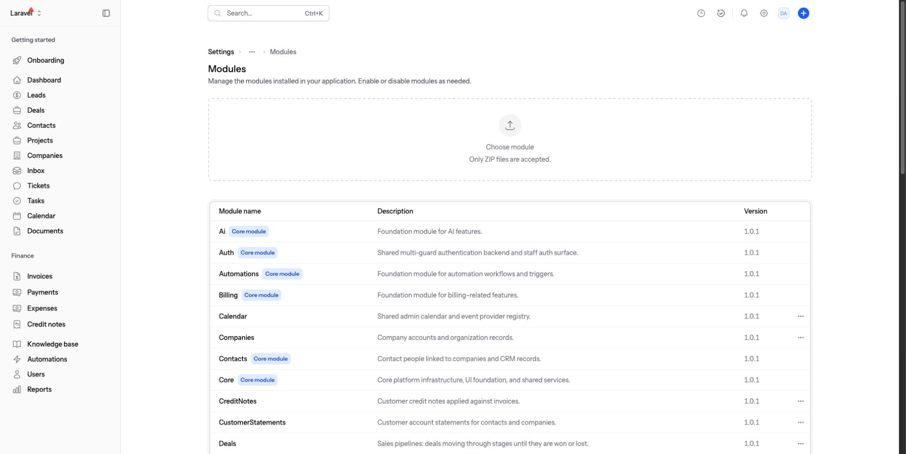
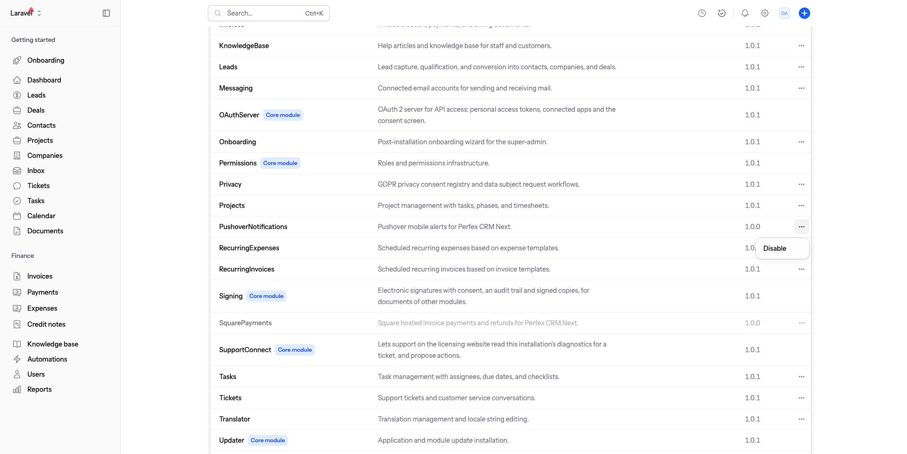
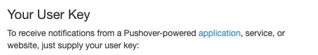
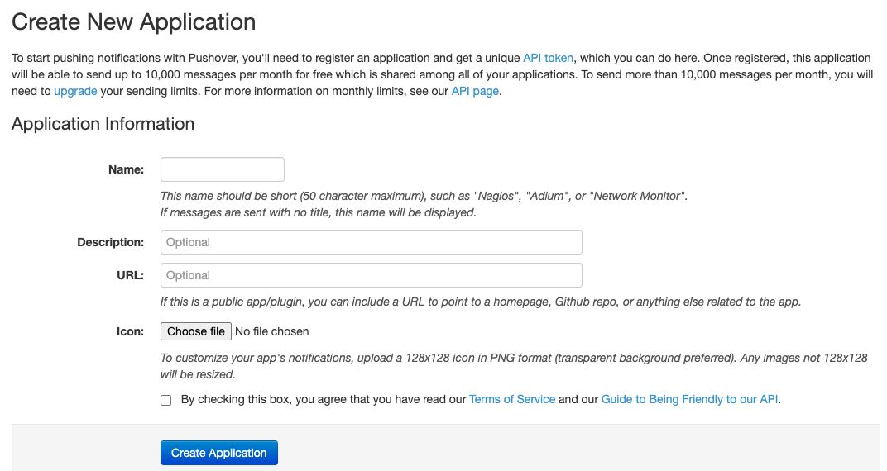
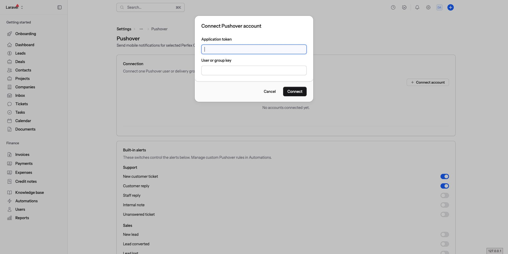
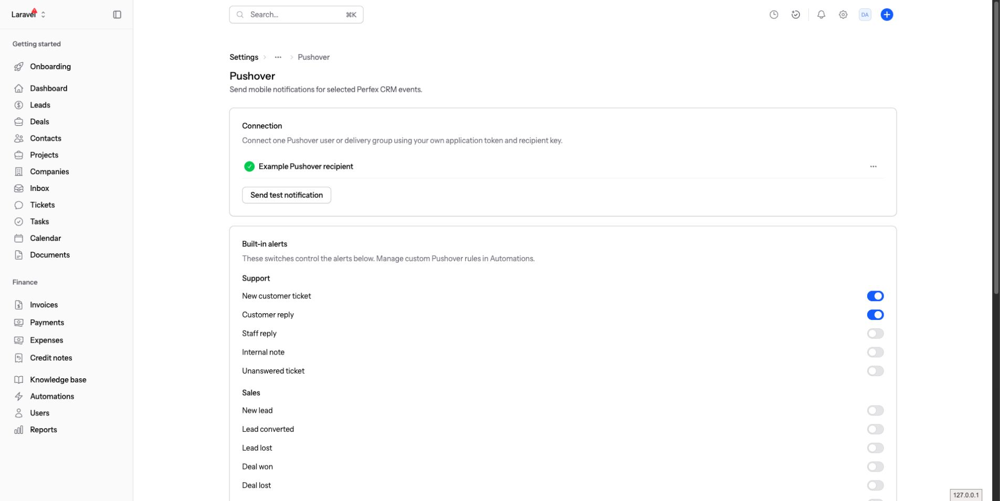
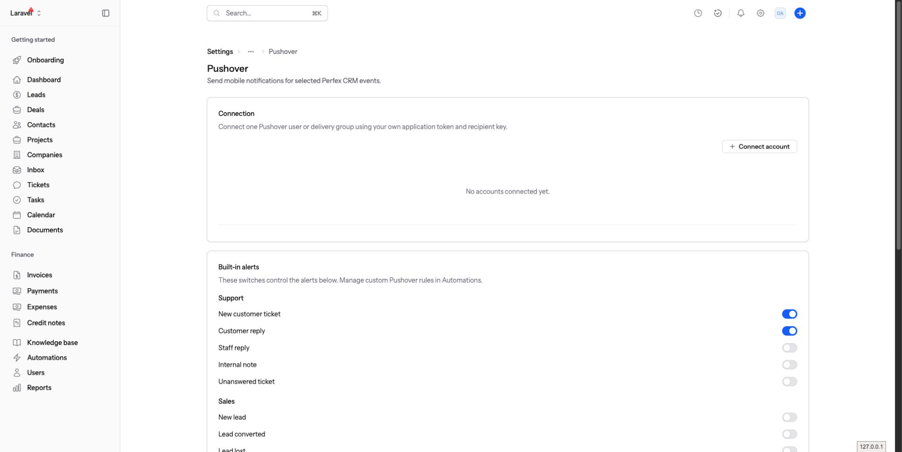
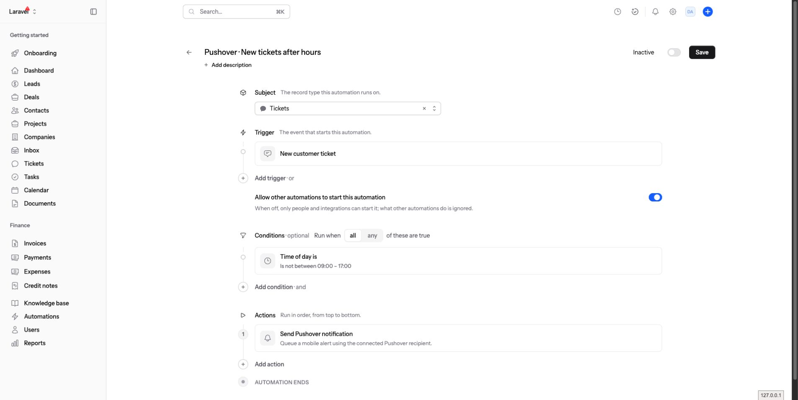

# Set up Pushover Notifications for Perfex CRM Next

For Pushover Notifications **1.0.0** and self-hosted **Perfex CRM Next 1.0.1 or later**. The module runs on the Laravel edition of Perfex. It requires the native **Integrations** and **Automations** modules and a working Next scheduler and queue.

## 1. Install the module in Perfex

1. Extract the outer CodeCanyon download. Inside it, find **`PushoverNotifications-1.0.0.zip`**. Leave that inner ZIP intact.
2. Sign in to Perfex as a super admin and open **Settings → Modules**. Select **Choose module** and upload the inner ZIP.
3. Find **PushoverNotifications** in the module list and check the version. Open its **Actions** menu and select **Enable** if the module is disabled. Complete any database maintenance Perfex prompts you to run. When the module is enabled, its menu offers **Disable**.

## 2. Set up Pushover and get your keys

1. Install the [Pushover client](https://pushover.net/clients) on the phone or other device that will receive alerts. Sign in and register the device. The [Pushover getting-started guide](https://support.pushover.net/i7-what-is-pushover-and-how-do-i-use-it) explains account and device setup.
2. Sign in to your [Pushover dashboard](https://pushover.net/). Find **Your User Key** and copy the value below that heading. To send to a group, [set up a Pushover delivery group](https://support.pushover.net/i169-how-do-i-send-messages-to-other-users-with-pushover) and use its **Group Key**.
3. Open [Create New Application](https://pushover.net/apps/build). In **Name**, enter a name you will recognise on your phone, such as `Perfex CRM Next`. Add any optional details you want, review Pushover’s terms and select **Create Application**.
4. On the application page, copy the value under **API Token**. Pushover explains the token in its [application token guide](https://support.pushover.net/i175-how-to-get-a-pushover-api-or-pushover-application-token).

| Copy from Pushover | Enter in Perfex |
| --- | --- |
| **API Token** on the application page | **Application token** |
| **Your User Key** on the dashboard or **Group Key** on the delivery group | **User or group key** |

Each buyer registers their own application. Keep both values private and enter them in your own Perfex installation.

## 3. Connect Pushover and send a test

1. In Perfex, open **Settings → Integrations → Pushover** and choose **Connect account**.
2. Paste the two values into **Application token** and **User or group key**, then select **Connect**.
3. Check that the connection appears under **Connection**. Select **Send test notification** and check the Pushover app on the intended device. The Perfex result shows whether Pushover accepted the send. The notification on the device confirms receipt.

## 4. Choose which events send alerts

Under **Built-in alerts**, turn on the events you want. All 24 switches start off on a fresh installation. The available groups depend on which Perfex modules are enabled.

For the first end-to-end check, enable **New customer ticket** and **Customer reply**. Open a test ticket as a customer and then post a separate customer reply. Look for one notification for each action.

| Group | Built-in alerts |
| --- | --- |
| Support | New customer ticket, customer reply, staff reply, internal note, unanswered ticket |
| Sales | New lead, lead converted, lead lost, deal won, deal lost, deal reopened |
| Quotes and estimates | First viewed, accepted, declined, approaching expiry |
| Invoices | Payment recorded, refund recorded, invoice overdue |
| Tasks and projects | New task, task completed, task comment, task due-date reminder, new project, project due-date reminder |

The built-in unanswered-ticket alert waits 30 minutes. An automatic acknowledgement leaves the timer running. Quote and estimate expiry reminders run three days before expiry. Task and project reminders run one and seven days before their due dates, respectively. Date reminders use the company timezone. Partial payments each count as payment events, and CSV imports run quietly.

## 5. Optional rule for new tickets after hours

1. Open **Automations → Create automation**. Give the rule a name and choose **Tickets** as its **Subject**.
2. Under **Trigger**, select **Add trigger**, open **Choose a trigger…** and choose **New customer ticket**.
3. Select **Add condition · optional → Time of day is**. Choose **Is not between** and enter **9** and **17** for an alert outside 09:00–17:00 in the company timezone.
4. Under **Actions**, select **Add action → Send Pushover notification**. Leave **Active** on and select **Create**.

Custom rules use the same connected recipient and have their own **Active** switch. For new-ticket alerts outside working hours only, leave the built-in **New customer ticket** switch off. An edited built-in rule is marked in Pushover settings. Restore its built-in definition there if you want to manage it from its original switch again.

## Troubleshoot a connection or alert

| What you see | What to check |
| --- | --- |
| Pushover is missing from Integrations | Confirm the module is enabled, database maintenance is complete, and you are signed in as a super admin. |
| Connection is rejected | Recheck where each key came from and whether the intended device is active in Pushover. Update the credentials to rotate a token for the same recipient. Disconnect and connect again to change recipient. |
| Pushover accepts a test but the phone stays quiet | Check the connected recipient, device registration and device notification settings. See [Pushover's delivery troubleshooting](https://support.pushover.net/i14-not-receiving-pushover-notifications-from-3rd-party-software-services). |
| A test arrives but a CRM alert stays quiet | Check the relevant switch or custom rule, the rule history, and that Next's scheduler and queue are running. Check that a timed alert has reached its scheduled time. |
| Perfex reports a quota error | Check the message limit in your Pushover account. |
| Perfex shows **Delivery unknown** | Check the destination device before sending another test. |

Alerts include a short record reference and an admin link when available. The link opens in Perfex and respects normal record access.
